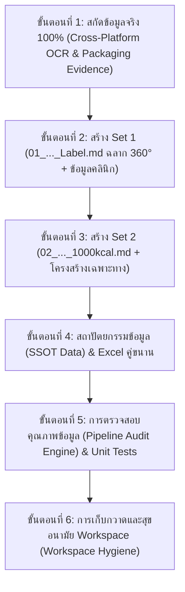

# Medical Food Data Pipeline & 1,000 kcal Standardization

แนวทางปฏิบัติและขั้นตอนการทำงานมาตรฐาน (Standard Operating Procedure: SOP) ข้ามแพลตฟอร์มสำหรับการสกัดข้อมูลผลิตภัณฑ์อาหารทางการแพทย์ (Medical Food / Enteral Nutrition) จากรูปถ่ายบรรจุภัณฑ์จริงหรือเอกสารทางการ ถอดข้อความฉลาก 360 องศา แปลงค่าสารอาหารต่อ 1,000 กิโลแคลอรีตามประกาศกระทรวงสาธารณสุข ฉบับที่ 445 พ.ศ. 2566 ออกแบบสถาปัตยกรรมข้อมูลโมดูลาร์ สร้างสมุดงาน Excel ไดนามิกคู่ขนานทั้งระดับผลิตภัณฑ์และระดับแบรนด์ และทดสอบความถูกต้องอัตโนมัติ

> [!NOTE]
> **นิยามและโครงสร้างโฟลเดอร์ทักษะ (`<skill_dir>`):**
> ในคู่มือฉบับนี้ สัญลักษณ์ `<skill_dir>` หมายถึงโฟลเดอร์รากของชุดทักษะนี้ (ไดเรกทอรีที่มีไฟล์ `SKILL.md` เช่น `skills/medical-food-data-pipeline`)
> การเรียกใช้สคริปต์ในตัวอย่างคำสั่งแสดงด้วย `python3` (สำหรับ macOS / Linux) สำหรับระบบปฏิบัติการ Windows ให้ใช้ `python` หรือ `py -3`

> [!CAUTION]
> **ข้อจำกัดความรับผิดชอบทางคลินิกและการทวนสอบข้อมูล (Clinical & Regulatory Disclaimer):**
> ผลลัพธ์และสมุดงาน Excel จากทักษะนี้เป็นเพียงเครื่องมือช่วยจัดการและคำนวณข้อมูลเบื้องต้น **ต้องตรวจสอบค่าตัวเลขและหน่วยสารอาหารทุกจุดเทียบกับฉลากผลิตภัณฑ์จริงและประกาศกระทรวงสาธารณสุขที่บังคับใช้เสมอ** และการนำไปใช้ดูแลผู้ป่วยหรือกำหนดสูตรอาหารทางสายให้อาหารต้องอยู่ภายใต้ดุลยพินิจและการอนุมัติของบุคลากรทางการแพทย์ (นักกำหนดอาหาร เภสัชกร หรือแพทย์) เท่านั้น

---

## 1. เกณฑ์และสูตรคณิตศาสตร์มาตรฐาน (Core Mathematical Invariants)

ทุกขั้นตอนการคำนวณต้องยึดหลักเกณฑ์และสูตรทางคณิตศาสตร์อย่างเคร่งครัด:

1. **ปริมาณผงต่อ 1,000 kcal (Powder required per 1,000 kcal):**
   $$\text{ผงต่อ 1,000 kcal (กรัม)} = \left(\frac{1,000}{\text{พลังงานต่อ 100g}}\right) \times 100$$
   * *กรณีฉลากใช้ฐาน 1 หน่วยบริโภค (Serving-Based Formula):*
     $$\text{ผงต่อ 1,000 kcal (กรัม)} = \left(\frac{\text{น้ำหนัก 1 หน่วยบริโภค (g)}}{\text{พลังงานต่อ 1 หน่วยบริโภค (kcal)}}\right) \times 1,000$$
     และพลังงานต่อ 100g คำนวณไดนามิกใน Excel ด้วย `=ROUND(B_srv_kcal*(100/B_srv_g), 2)`
2. **ตัวคูณปรับสัดส่วน (Scale Factor):**
   $$\text{Scale Factor} = \frac{1,000}{\text{พลังงานต่อ 100g}}$$
3. **ปริมาณสารอาหารหรือส่วนประกอบต่อ 1,000 kcal:**
   $$\text{ปริมาณต่อ 1,000 kcal} = \text{ปริมาณต่อ 100g} \times \text{Scale Factor}$$
   หรือแปลงจากเปอร์เซ็นต์ส่วนประกอบ (% w/w):
   $$\text{ปริมาณส่วนประกอบต่อ 1,000 kcal (g)} = \text{ผงต่อ 1,000 kcal} \times \left(\frac{\% \text{ w/w}}{100}\right)$$
4. **การตรวจสอบสัดส่วนการกระจายพลังงาน (Macronutrient Energy Distribution):**
   * โปรตีน: $\text{กรัมต่อ 1,000 kcal} \times 4\text{ kcal/g}$
   * ไขมัน: $\text{กรัมต่อ 1,000 kcal} \times 9\text{ kcal/g}$
   * คาร์โบไฮเดรต: $\text{กรัมต่อ 1,000 kcal} \times 4\text{ kcal/g}$
   * พลังงานรวมต้องใกล้เคียง $1,000\text{ kcal}$ และสัดส่วน % Energy ต้องสอดคล้องกับข้อกำหนดบนฉลาก (เช่น $16:34:50$, $19:43:38$, หรือ $20:35:45$)
5. **ปริมาตรของเหลวต่อ 1,000 kcal สำหรับสูตรน้ำพร้อมดื่ม (RTD Liquid Invariant):**
   $$\text{ปริมาตรต่อ 1,000 kcal (mL)} = \left(\frac{1,000}{\text{พลังงานต่อหน่วยบริโภค (kcal)}}\right) \times \text{ปริมาตรหน่วยบริโภค (mL)}$$
   *ตัวอย่าง:* สูตรเฉพาะโรคไตชนิดน้ำพร้อมดื่ม (425 kcal ต่อกล่อง 237 mL) $\rightarrow (1,000 / 425) \times 237 = 557.65\text{ mL}$
6. **เกณฑ์บรรจุภัณฑ์แบบซอง (Multi-Pack Sachet Accounting Invariant):**
   * น้ำหนักสุทธิรวมบรรจุภัณฑ์:
     $$\text{น้ำหนักสุทธิรวม (g)} = \text{จำนวนซอง} \times \text{น้ำหนักต่อซอง (g)}$$
   * พลังงานรวมทั้งกล่อง:
     $$\text{พลังงานรวม (kcal)} = \text{น้ำหนักสุทธิรวม (g)} \times \left(\frac{\text{พลังงานต่อ 100g}}{100}\right)$$
   * *ตัวอย่าง:* สูตรบรรจุแบบกล่องหลายซอง (5 ซอง x 74 กรัม = 370 กรัม; พลังงาน 410 kcal/100g) $\rightarrow 370 \times 4.10 = 1,517.0\text{ kcal}$ ต่อกล่อง ในเอกสาร Set 1 และ Set 2 ต้องระบุทั้งน้ำหนักต่อซองและน้ำหนักสุทธิรวม ห้ามนำน้ำหนัก 1 ซองมาใส่เป็นน้ำหนักสุทธิของผลิตภัณฑ์เด็ดขาด

---

### 1.1 มาตรฐานการแปลงหน่วยกลาง (Unit Normalization & MOPH Notification No. 445 Invariants)

เพื่อคงหลักฐานบนฉลากจริง 100% ใน **Set 1** และ `scripts/<brand>_data.py` ขณะเดียวกันสามารถเปรียบเทียบสารอาหารข้ามสูตรที่ระดับ **1,000 kcal** ได้อย่างเป็นมาตรฐานเดียวกันใน **Set 2** และ **Excel** ให้ใช้เกณฑ์อ้างอิงตาม **ประกาศกระทรวงสาธารณสุข (ฉบับที่ ๔๔๕) พ.ศ. ๒๕๖๖ เรื่อง ฉลากโภชนาการ (MOPH Notification No. 445)**:

1. **เกณฑ์หน่วยมาตรฐาน 33 สารอาหาร (บัญชีหมายเลข 3: Thai RDIs, ASCII-safe):**
   * **กรัม (`g`):** ไขมันทั้งหมด (65), ไขมันอิ่มตัว (20), โปรตีน (50), คาร์โบไฮเดรตทั้งหมด (300), ใยอาหาร (25)
   * **มิลลิกรัม (`mg`):** คอเลสเตอรอล (300), วิตามินบี 1 (1.2), วิตามินบี 2 (1.2), กรดแพนโทธีนิค (5), วิตามินบี 6 (1.3), วิตามินซี (100), แคลเซียม (1,000), ฟอสฟอรัส (700), แมกนีเซียม (310), เหล็ก (22), สังกะสี (11), แมงกานีส (3), โซเดียม (2,000), โพแทสเซียม (3,500), คลอไรด์ (2,300)
   * **ไมโครกรัม (`mcg`):** วิตามินดี (15), วิตามินเค (60), ไบโอติน (30), วิตามินบี 12 (2.4), ไอโอดีน (150), ซีลีเนียม (60), ทองแดง (900), โมลิบดินัม (45), โครเมียม (35)
   * **หน่วยเทียบเท่าชีวภาพเฉพาะ (Equivalents):**
     - วิตามินเอ: `mcg RAE` (800)
     - วิตามินอี: `mg alpha-TE` (9)
     - ไนอะซิน (วิตามินบี 3): `mg NE` (15)
     - โฟเลต: `mcg DFE` (400)
2. **ค่าการแปลงหน่วยสำหรับวิตามินและแร่ธาตุ (ข้อ 2.5 และ SI Scaling):**
   * **SI Scaling & หน่วยภาษาไทย:** `1 g = 1,000 mg = 1,000,000 mcg` (แปลงหน่วยภาษาไทย `กรัม`/`มิลลิกรัม`/`ไมโครกรัม` เป็น `g`/`mg`/`mcg` ตามสัดส่วนเดียวกัน)
   * **วิตามินเอ (`mcg RAE`):** `1 mcg RAE = 1 mcg retinol = 3.33 IU retinol` (`1 IU = 0.3 mcg RAE`), `= 12 mcg beta-carotene = 20 IU beta-carotene` (`1 IU = 0.05 mcg RAE`), `= 24 mcg alpha-carotene/beta-cryptoxanthin`; กรณีฉลากระบุเฉพาะ `IU` หรือ `mcg RE` (preformed) ให้ใช้ค่าเริ่มต้น `1 IU = 0.3 mcg RAE` และ `1 mcg RE = 1 mcg RAE` พร้อมระบุหมายเหตุสมมติฐาน
   * **ไนอะซิน (`mg NE`):** `1 mg NE = 1 mg niacin = 60 mg tryptophan` (`1 mg = 1 mg NE`, `1,000 mcg = 1 mg NE`)
   * **วิตามินอี (`mg alpha-TE`):** `1 mg alpha-TE = 1 mg d-alpha-tocopherol (RRR) = 1.5 IU` หรือ `= 2 mg all-rac-alpha-tocopherol (dl-alpha) = 2.22 IU`; ให้ตรวจสอบส่วนประกอบใน `ingredients` หากเป็น `d-alpha` ใช้หาร `1.5` หากเป็น `dl-alpha`/`all-rac` หรือไม่ระบุให้ใช้ค่าเริ่มต้นหาร `2.22` (และ `1 mg TE = 1 mg alpha-TE`)
   * **วิตามินดี (`mcg`):** `1 mcg cholecalciferol = 40 IU vitamin D` (`IU / 40`)
   * **โฟเลต (`mcg DFE`):** `1 mcg DFE = 1 mcg food folate = 0.6 mcg folic acid added to food`; สำหรับอาหารทางการแพทย์ที่เติมกรดโฟลิกสังเคราะห์ ให้แปลงด้วย `mcg / 0.6` (`x 1.6667`) พร้อมระบุหมายเหตุสมมติฐาน
3. **การใช้งานโมดูลแปลงหน่วย:**
   * ใช้โมดูลกลาง `<skill_dir>/scripts/unit_normalizer.py` เป็นตัวกำหนด Canonical Key, ตัวคูณแปลงหน่วย (`factor`), หน่วยมาตรฐาน (`target_unit`), และหมายเหตุสมมติฐาน
   * ปรับปรุงเอกสาร Set 2 และ Excel ทั้ง Workspace อัตโนมัติด้วย:
     ```bash
     # macOS / Linux
     python3 <skill_dir>/scripts/apply_unit_normalization.py --root .
     # Windows
     py -3 <skill_dir>/scripts/apply_unit_normalization.py --root .
     ```
   * ใน **Excel** (ทั้ง Standalone และ Brand Master) ห้ามฮาร์ดโค้ดค่าที่ Normalize แล้ว ให้ใส่ตัวคูณแปลงหน่วยลงในเซลล์อ้างอิงและคำนวณค่ามาตรฐานด้วยสูตร `=ROUND(raw_1000kcal_cell * factor_cell, 2)`

---

## 2. ขั้นตอนการดำเนินงาน 6 ขั้นตอน (6-Step Pipeline)



---

### ขั้นตอนที่ 1: สกัดข้อมูลหลักฐานจริง 100% (Evidence Extraction)
1. สแกนรูปถ่ายบรรจุภัณฑ์จริงความละเอียดสูงทุกด้าน หรือเอกสาร PDF ทางการ
2. สกัดข้อความจากภาพบรรจุภัณฑ์ด้วย `<skill_dir>/scripts/ocr_row_extractor.py`:
   ```bash
   # macOS / Linux
   python3 <skill_dir>/scripts/ocr_row_extractor.py label.jpg --format table
   # Windows
   py -3 <skill_dir>/scripts/ocr_row_extractor.py label.jpg --format table
   ```
   * **ความเข้ากันได้ข้ามแพลตฟอร์ม (OCR Backends):**
     - macOS: Apple Vision Framework (`--backend vision`)
     - Windows: Windows Media OCR API (`--backend winrt`)
     - ลินุกซ์/เซิร์ฟเวอร์: Tesseract OCR (`--backend tesseract`)
     - ระบบอัตโนมัติ: โหมด VLM Fallback (`--backend vlm_fallback`)
   * **การตรวจสอบแบบ Dual-Pass:**
     - เปรียบเทียบกับผลการสกัดรอบแรกด้วย `--compare-json <pass1.json>`
     - เปรียบเทียบกับ Single Source of Truth ด้วย `--data-py <brand_data.py>`
3. ข้อมูลที่ต้องสกัดให้ครบทุกมุม:
   * **ด้านหน้ากระป๋อง/กล่อง:** ชื่อการค้า (ไทย/อังกฤษ), ชื่อสามัญ, ชนิดของอาหารทางการแพทย์, กลิ่น/รสชาติ, ปริมาณสุทธิ
   * **แผงข้อมูลทางคลินิก:** Sole source, Isotonic, Osmolality (mOsm/kg), Renal Solute Load, ดัชนีน้ำตาล (GI), โหลดน้ำตาล (GL), Respiratory Quotient (RQ), Lactose Free, Gluten Free
   * **แผงส่วนประกอบสำคัญ:** ลำดับส่วนประกอบและเปอร์เซ็นต์ (% w/w) ทุกรายการ
   * **แผงตารางโภชนาการ (Nutrition Facts):** สารอาหารทุกตัว ต่อ 100 กรัม, ต่อ 1 หน่วยบริโภค, และ % RDI / % WHO
   * **ข้อกำหนดช้อนตวงและการชง:** น้ำหนักต่อ 1 ช้อนตวง (กรัม และ kcal), สัดส่วนการผสมน้ำ, ปริมาตรสารละลายที่ได้
   * **ตารางการผสมความเข้มข้นทางคลินิก (ถ้ามี):** สัดส่วนการผสมสำหรับ 0.5, 1.0, 1.5, 2.0 kcal/มล. และค่า Osmolality แต่ละระดับ
   * **ข้อมูลทะเบียนและกฎหมาย:** เลขสารบบอาหาร (อย.), เลขที่โฆษณา (ฆอ.), รหัส MiT, บาร์โค้ด, ตราฮาลาล (Halal Certification), ผู้ผลิต, ผู้นำเข้า/จัดจำหน่าย, วันผลิต/หมดอายุ, และ Lot Number
4. **กฎตรวจสอบความถูกต้องของ OCR ด้วยพิกัดแถว และภาพจริง (Y-Aligned OCR & Visual Audit):**
   * ตรวจสอบความสอดคล้องของทุกแถวในตารางโภชนาการด้วยสูตร $\text{ค่าต่อ 1,000 kcal} \approx \text{ค่าต่อหน่วย} \times \text{Scale Factor}$ เพื่อตรวจจับอาการแถวเลื่อนหรือตัวเลขเกิน (เช่น `1141` แทน `141`)
   * หากจำนวนแถวไม่ครบ ค่าไม่สมเหตุสมผล หรือ OCR อ่านข้ามบรรทัด **ต้องเปิดดูภาพต้นฉบับที่คมชัดที่สุดด้วยเครื่องมือตรวจดูภาพ/วิสัยทัศน์คอมพิวเตอร์ (Multimodal Image Inspection Tool) โดยตรง** เพื่อยืนยันตัวเลขก่อนบันทึกลงไฟล์ข้อมูล

---

### ขั้นตอนที่ 2: สร้างเอกสาร Set 1 ฉลากเต็ม 360 องศา (`01_<Product>_Label.md`)
โครงสร้างเอกสารต้องประกอบด้วย 5 หมวดเนื้อหาหลัก พร้อมการควบคุมมาตรฐานความสอดคล้อง (Clinical & Regulatory Invariants):
1. **ข้อมูลทั่วไปและเอกลักษณ์ผลิตภัณฑ์ (General Information):**
   * ชื่อไทย/อังกฤษ, เลข อย., ฆอ., MiT, Barcode, มาตรฐานฮาลาล, ขนาดบรรจุ, ผู้ผลิต, ผู้นำเข้า/จัดจำหน่าย, วันผลิต/หมดอายุ/Lot, อายุการเก็บรักษา, ศูนย์ผู้บริโภค
   * *กฎสินค้านำเข้า:* สินค้านำเข้าที่ไม่มีรหัส MiT ต้องระบุ `"รหัส Made in Thailand (MiT): N/A (สินค้านำเข้า)"` และกรณีไม่มีเลข ฆอ. บนฉลากให้ระบุ `"เลขที่โฆษณา (ฆอ.): ไม่ระบุบนบรรจุภัณฑ์ (อาหารทางการแพทย์)"` ห้ามเว้นว่าง
2. **จุดเด่นและคุณสมบัติทางเภสัชวิทยาคลินิก (Key Clinical Features):**
   * ข้อบ่งใช้, กลุ่มเป้าหมาย, คุณลักษณะทางโภชนาการ, แหล่งโปรตีน/ไขมัน/คาร์โบไฮเดรต, ระบบใยอาหาร, Osmolality
   * *ข้อห้ามใช้เด็ดขาด (Strict Clinical Contraindications):*
     - ทุกผลิตภัณฑ์: ต้องมีข้อความ `"ห้ามให้ทางหลอดเลือดดำ (Not for intravenous use)"`
     - สูตรทั่วไปสำหรับผู้ใหญ่และเด็ก: ต้องระบุข้อห้ามใช้ในภาวะ `"ห้ามใช้ในผู้ป่วยที่มีภาวะกาแลคโตซีเมีย (Galactosemia)"` (เว้นแต่สูตรนั้นระบุข้อบ่งใช้เฉพาะ)
     - สูตรเสริมภูมิคุ้มกัน (Immune-enhancing formula ที่มี L-Arginine สูง): ต้องระบุ `"ห้ามใช้ในผู้ป่วยที่มีภาวะติดเชื้อในกระแสเลือดขั้นรุนแรง (Severe Sepsis)"`
3. **ส่วนประกอบที่สำคัญเชิงปริมาณบนฉลากจริง (% w/w):**
   * ตารางแสดงส่วนประกอบทุกตัวเรียงตามลำดับ % w/w จากมากไปน้อย
   * *แถวผลรวมบังคับ:* ต้องมีแถวผลรวมด้านล่างสุดเสมอ (`| รวม | 100.00% |` หรือระบุเปอร์เซ็นต์จริงพร้อมคำอธิบายสารแต่งกลิ่นรส/สารเจือปนอาหาร)
   * *กรณีสูตรน้ำพร้อมดื่ม (RTD Liquid):* ฉลากมักแสดง `% w/w` เฉพาะสารแห้ง/สารออกฤทธิ์ (เช่น ~25–35%) ส่วนที่เหลือให้ระบุเป็น `น้ำบริสุทธิ์ วัตถุเจือปนอาหาร และสารแต่งกลิ่น` โดยคำนวณใน Excel ด้วย `=ROUND(1-SUM(...), 6)` เพื่อให้แถวผลรวมครบ `100.00%` เสมอ
   * แสดงสารเจือปนอาหาร (INS) ทุกตัว และสารก่อภูมิแพ้อย่างชัดเจน
4. **วิธีการเตรียมและการให้ทางสายยาง (Preparation & Administration):**
   * มาตรฐานช้อนตวง, สูตรการชงดื่ม, ตารางการผสมความเข้มข้นทางคลินิก (Dilution Table 0.5, 1.0, 1.5, 2.0 kcal/mL)
   * *มาตรฐานการให้ทางสายยาง (Tube Administration Protocol):* ต้องระบุอัตราการให้แบบหยดต่อเนื่อง (Continuous Drip Rate เช่น 20-50 mL/h), การให้เป็นมื้อ (Intermittent/Bolus Feeding เช่น 200-300 mL ต่อมื้อ), และขั้นตอนการ Flush สายยางด้วยน้ำต้มสุกสะอาด 20-30 mL ก่อนและหลังให้เสมอ
   * การเก็บรักษาหลังเปิดกระป๋อง (ใช้ให้หมดภายใน 1 เดือน) และหลังชงสารละลาย
5. **ตารางข้อมูลโภชนาการฉบับเต็ม (Full Nutrition Facts):**
   * ตารางเปรียบเทียบสารอาหารทุกรายการ: ต่อ 100g, ต่อ 1 หน่วยบริโภค (serving), และ % WHO RNI หรือ % Thai RDI (ถ้าบนฉลากมีระบุ)

> [!IMPORTANT]
> **กฎการจัดการหลายกลิ่น/หลายสูตรในโฟลเดอร์เดียวกัน (Multi-Flavor Invariant):**
> หากโฟลเดอร์ใดมีมากกว่า 1 กลิ่น หรือมีทั้งสูตรผง/สูตรน้ำ ให้แยกสร้างไฟล์ Set 1 และ Set 2 ต่อ 1 กลิ่น/สูตรเสมอ เช่น `01_<Product>_<Flavor>_Label.md` ห้ามเขียนรวมหรือเขียนทับกัน

---

### ขั้นตอนที่ 3: สร้างเอกสาร Set 2 ส่วนประกอบและสารอาหารต่อ 1,000 kcal (`02_<Product>_Ingredients_Nutrition_1000kcal.md`)
โครงสร้างเอกสารต้องประกอบด้วย 5 หมวดบังคับ:
1. **กล่องข้อกำหนดการคำนวณมาตรฐาน (Calculation Standard Box):**
   * ระบุพลังงานต่อ 100g (หรือ 100mL), พลังงานเป้าหมาย 1,000 kcal, ปริมาณผงที่ต้องใช้ต่อ 1,000 kcal (g), ตัวคูณ Scale Factor (ทศนิยม 6 ตำแหน่ง)
   * *ปริมาตรสารละลายที่ได้ (Reconstituted Liquid Volume):* ต้องระบุปริมาตรสารละลายที่ผสมได้ที่ระดับ 1,000 kcal เสมอ (เช่น ~1,000 mL สำหรับสูตร 1.0 kcal/mL หรือ ~800 mL สำหรับสูตร 1.25 kcal/mL)
2. **ตารางส่วนประกอบสำคัญต่อ 1,000 kcal:** คำนวณปริมาณเป็นกรัมของแต่ละส่วนประกอบจาก % w/w บนฉลากจริง
3. **ตารางโครงสร้างสารอาหารพิเศษเฉพาะทาง (Special Nutritional Systems):** เช่น ระบบ Multi-Fiber 5 ชนิด, ระบบ Synbiotics (โพรไบโอติก + พรีไบโอติกคู่), ระบบ Low GI & PHGG, 3 สารอาหารภูมิคุ้มกัน (Arginine, Nucleotides, Fish Oil), หรือ 100% เวย์เปปไทด์ + 70% MCT
4. **ตารางคุณค่าทางโภชนาการต่อ 1,000 kcal ครบถ้วน:** สารอาหารครบทุกรายการ (พลังงาน, ไขมันย่อย, โปรตีน, กรดอะมิโนจำเป็น, คาร์โบไฮเดรต, น้ำตาล, ใยอาหารย่อย, วิตามินทุกตัว, แร่ธาตุทุกตัว) พร้อมคอลัมน์มาตรฐานการแปลงหน่วยตามประกาศกระทรวงสาธารณสุข ฉบับที่ 445
5. **ตารางตรวจสอบสัดส่วนการกระจายพลังงาน (Macronutrient Distribution):** สรุปโปรตีน, ไขมัน, คาร์โบไฮเดรต พร้อมคำนวณพลังงานจริง (P x 4, F x 9, C x 4), คำนวณ % kcal จริง, และเทียบกับข้อกำหนดฉลาก

---

### ขั้นตอนที่ 4: สถาปัตยกรรมข้อมูลโมดูลาร์และการสร้าง Excel คู่ขนาน (Dual-Delivery Excel Standards)

#### 4.1 สถาปัตยกรรมข้อมูลเป็นศูนย์กลาง (SSOT Pattern)
* อ้างอิงและปฏิบัติตาม Canonical Schema ใน `<skill_dir>/assets/brand_data_template.py`:
  - `BRAND_META`: พจนานุกรมชื่อแบรนด์และชื่อไฟล์ Master Excel
  - `PRODUCTS`: รายการพจนานุกรมผลิตภัณฑ์ที่ประกอบด้วย `id`, `folder`, `trade_th`, `trade_en`, `base_type`, `base_value`, `base_kcal`, `serving_g`, `serving_kcal`, `nominal_pcf`, `clinical_exemptions`, `ingredients`, และ `nutrients`
  - ฟิลด์ `clinical_exemptions` บรรจุรายการสารอาหารที่ได้รับการยกเว้นจากการตรวจ Outlier เช่น สูตรไต (`["potassium", "vitamin_d"]`), สูตรตับ, หรือสูตรเฉพาะทางอื่นๆ
* แยกข้อมูลสารอาหารและส่วนประกอบของแต่ละแบรนด์ออกมาเป็นไฟล์โมดูลาร์ เช่น `scripts/sample_data.py`
* ใช้เป็น **Single Source of Truth** ที่แชร์ร่วมกันระหว่างสคริปต์สร้าง Markdown (Set 1 & Set 2), สคริปต์สร้าง Excel และชุดทดสอบ Unit Tests
* **Data-Driven Generator Pattern:** ห้ามฮาร์ดโค้ดตารางตัวเลขสารอาหารซ้ำในสคริปต์ ให้ดึงข้อมูลจากไฟล์โมดูลาร์เสมอ
* **Atomic Regeneration:** เมื่อบรรจุภัณฑ์จริงมีการปรับปรุงสูตร ให้แก้ไขที่ไฟล์ข้อมูลโมดูลาร์เป็นลำดับแรก แล้วสั่งรันสร้างเอกสาร Set 1, Set 2, Standalone Excel, Master Excel และ Brand `README.md` พร้อมกันในรอบเดียว

#### 4.2 มาตรฐานการสร้างไฟล์ Excel คู่ขนาน (Dual-Delivery Standards)
ต้องส่งมอบไฟล์ Excel **2 ระดับเสมอ**:
1. **Standalone Product Excel:** บันทึกไว้ในโฟลเดอร์ของผลิตภัณฑ์นั้นๆ เช่น `<Brand>/<Product>/<Product>_Nutrition_1000kcal.xlsx`
   * มีแผ่นงาน `00_ภาพรวมผลิตภัณฑ์` บรรจุตารางมาตรฐานการคำนวณ โดยเซลล์ `$B$11` เป็นสูตรคำนวณผงต่อ 1,000 kcal: `=ROUND((1000/B8)*100, 2)`
   * แผ่นงานผลิตภัณฑ์เชื่อมโยงสูตรสารอาหารและส่วนประกอบไปยัง `'00_ภาพรวมผลิตภัณฑ์'!$B$11`
   * กรณีมีหลายกลิ่นในโฟลเดอร์ ให้สร้างชีตแยกตามกลิ่นในเล่มเดียวกัน
2. **Brand Master Excel:** บันทึกไว้ที่โฟลเดอร์หลักของแบรนด์ เช่น `<Brand>/<Brand>_Nutrition_1000kcal.xlsx`
   * มีแผ่นงาน `00_ภาพรวมเปรียบเทียบ_1000kcal` เชื่อมโยงดึงสารอาหารหลักของทุกผลิตภัณฑ์มาเปรียบเทียบข้ามสูตร
   * มีแผ่นงาน `01_สรุปพลังงาน_1000kcal` สรุปฐานพลังงานและผงต่อ 1,000 kcal ของทุกสูตร

#### 4.3 กฎเหล็กเรื่องสูตรไดนามิก 100% และการจัดรูปแบบ Corporate Blue
* **ห้ามใส่ค่าผลลัพธ์ฮาร์ดโค้ดสำหรับตัวเลขที่คำนวณได้เด็ดขาด**
* **สูตรสำหรับผลิตภัณฑ์ชนิดผงแห้ง (Powder Formulas):**
  - ผงต่อ 1,000 kcal: `=ROUND((1000/D{energy_row})*100, 2)` หรือ `=ROUND((1000/B8)*100, 2)`
  - สารอาหารต่อ 1,000 kcal: `=ROUND((D{row}/100)*{powder_cell_ref}, 2)`
  - ส่วนประกอบต่อ 1,000 kcal: `=ROUND(C{row}*{powder_cell_ref}, 2)`
* **สูตรสำหรับผลิตภัณฑ์ชนิดน้ำพร้อมดื่ม (Ready-to-Drink / RTD Liquid Formulas):**
  - ปริมาตรของเหลวต่อ 1,000 kcal: `=ROUND((1000/D{energy_row})*{serving_ml}, 2)`
  - สารอาหารต่อ 1,000 kcal: `=ROUND((D{row}/$D${energy_row})*1000, 2)`
  - ส่วนประกอบต่อ 1,000 kcal: `=ROUND(C{row}*{volume_cell_ref}, 2)`
* **สูตรพลังงานและสัดส่วนทั่วไป:**
  - พลังงานจากสารอาหาร: `=ROUND(B{row}*C{row}, 2)`
  - สัดส่วนพลังงานจริง (% Energy): `=ROUND((D{row}/$D${total_energy_row})*100, 2)`
  - ผลรวมทุกตาราง: `=ROUND(SUM(...), 2)`
* **แนวทางการจัดรูปแบบตามคู่มือ:**
  - ปฏิบัติตามแนวทางใน `<skill_dir>/references/excel_styling_guide.md`
  - ใช้ชุดสี Corporate Blue Theme (`#1F4E78`, `#2F5597`, `#D9E1F2`, `#F2F2F2`, `#FFF2CC`, `#E2EFDA`)
  - รองรับทั้งฟอนต์ `TH Sarabun New` และ `Cordia New` พร้อมคำนวณความกว้างคอลัมน์ UTF-8 Thai Glyphs บวกระยะปลอดภัย `+5` เพื่อป้องกันข้อความล้นบน macOS และ LibreOffice
  - เปิดเส้นตารางเสมอ: `ws.views.sheetView[0].showGridLines = True`
  - ตรึงแนวแผ่นงาน (Freeze Panes) ใต้หัวตารางเสมอ

---

### ขั้นตอนที่ 5: การตรวจสอบคุณภาพข้อมูล (Pipeline Audit Engine) & Unit Tests

#### 5.1 ระบบตรวจสอบคุณภาพข้อมูลแบบอัตโนมัติ (Pipeline Audit Engine)
เรียกใช้เครื่องมือตรวจสอบคุณภาพข้อมูลของระบบ `<skill_dir>/scripts/pipeline_audit.py`:
```bash
# macOS / Linux
python3 <skill_dir>/scripts/pipeline_audit.py --data scripts/<brand>_data.py --workspace . --cohort-min 5
# Windows
py -3 <skill_dir>/scripts/pipeline_audit.py --data scripts/<brand>_data.py --workspace . --cohort-min 5
```
เครื่องมือนี้ทำการตรวจสอบ 5 ด่านหลักอย่างเข้มงวด:
1. **Dual-Column Ratio Consistency:** ตรวจสอบความสอดคล้องระหว่างค่าต่อหน่วยบริโภคและค่าต่อ 100g ให้ตรงกับอัตราส่วนน้ำหนัก
2. **Macro Energy Balance:** ตรวจสอบพลังงานจากสารอาหารหลัก $4\times P + 9\times F + 4\times C$ ว่าตรงกับพลังงานรวมที่ระบุบนฉลากภายในเกณฑ์ความคลาดเคลื่อน $\pm 6\%$
3. **Thai RDI Bounds Cross-Validation:** ตรวจสอบค่าสารอาหารต่อ 1,000 kcal ตามประกาศกระทรวงสาธารณสุข ฉบับที่ 445 ให้อยู่ในช่วง $2\% - 1000\%$ Thai RDI โดยเคารพข้อยกเว้นใน `clinical_exemptions`
4. **Cohort 10x Outlier Detection:** ตรวจสอบค่าผิดปกติระดับ $\ge 10\times$ หรือ $\le 0.1\times$ เทียบกับมัธยฐานของกลุ่มผลิตภัณฑ์ (จะทำงานเมื่อมีขนาดกลุ่ม $\ge 5$ ผลิตภัณฑ์ขึ้นไป และข้ามอย่างสะอาดเมื่อมีขนาดกลุ่มน้อยกว่า)
5. **Markdown & Excel Parity:** ยืนยันว่าไฟล์ Set 2 และไฟล์ Standalone Excel ทุกไฟล์มีอยู่จริง และมีค่าพลังงานตรงกับฐานข้อมูล SSOT

#### 5.2 สถาปัตยกรรมชุดทดสอบรวม (Consolidated Unit Tests)
* รวมไฟล์ทดสอบเป็น 1 ไฟล์ทดสอบต่อ 1 แบรนด์ในโฟลเดอร์ `tests/`
* รันการทดสอบระดับระบบด้วยคำสั่ง:
  ```bash
  python3 -m unittest discover tests
  ```
  ต้องผ่านการทดสอบทั้งหมด 100%

#### 5.3 รูปแบบการเชื่อมโยงไฟล์ (Portable Link Convention)
* สำหรับคลังข้อมูลใหม่หรือ GitHub Repositories ให้ใช้ Markdown link สัมพัทธ์ต่อ Workspace เป็นค่าเริ่มต้น: `[ชื่อเอกสาร](relative/path/to/file)`
* สำหรับสภาพแวดล้อมเฉพาะทางหรือชุดทดสอบเดิมที่บังคับใช้ URL รูปแบบเต็ม (`file:///`) ให้คงรูปแบบ `file:///` ตามข้อกำหนดของระบบนั้นๆ

---

### ขั้นตอนที่ 6: การเก็บกวาดและสุขอนามัย Workspace (Workspace Hygiene Protocol)

เป็นขั้นตอนบังคับหลังเสร็จสิ้นกระบวนการประมวลผล เพื่อให้ Workspace สะอาด ปลอดภัย และพร้อมใช้งานข้ามแพลตฟอร์ม:

1. **การทำความสะอาดข้ามแพลตฟอร์มด้วยสคริปต์อัตโนมัติ:**
   * เรียกใช้ `<skill_dir>/scripts/cleanup_workspace.py` เพื่อลบไฟล์แคชและไฟล์ขยะของระบบอย่างปลอดภัย:
     ```bash
     # ทดลองตรวจสอบรายการไฟล์ก่อนลบจริง (Dry Run)
     python3 <skill_dir>/scripts/cleanup_workspace.py . --dry-run
     # ลบจริงข้ามแพลตฟอร์ม (Windows, macOS, Linux)
     python3 <skill_dir>/scripts/cleanup_workspace.py .
     ```
   * สคริปต์นี้จะล้างไดเรกทอรี `__pycache__`, แคช `.ocr_cache/`, และไฟล์ขยะระบบปฏิบัติการ (`.DS_Store`, `Thumbs.db`) อย่างปลอดภัย
   * ปลอดภัยต่อโฟลเดอร์ Cloud-Synced (OneDrive / Google Drive) และทำงานได้โดยไม่ต้องพึ่งพา Git หรือคำสั่ง POSIX shell เฉพาะระบบ

2. **โปรโตคอลการประสานงานตัวแทนอัจฉริยะ (Multi-Agent Coordination & Hygiene):**
   * **Brand Sharding:** หากทำงานร่วมกันหลาย Worker ให้แบ่งงานตามขอบเขตแบรนด์เพื่อป้องกันการทับซ้อนของไฟล์
   * **Verifier Isolation:** ให้มีฝ่ายตรวจสอบ (Verifier) แยกต่างหากเพื่ออ่านและตรวจสอบความถูกต้องของผลลัพธ์
   * **Mandatory Decommissioning:** สั่งปิดและสิ้นสุดการทำงานของ Worker ทุกตัวเมื่อเสร็จสิ้นภารกิจ เพื่อคืนทรัพยากรหน่วยความจำสู่ระบบ

3. **ตรวจสอบสถานะ Workspace ครั้งสุดท้าย:**
   * รันการทดสอบ Unit Tests อีกครั้งเพื่อยืนยันว่าการเก็บกวาดไม่กระทบต่อความสมบูรณ์ของระบบ
